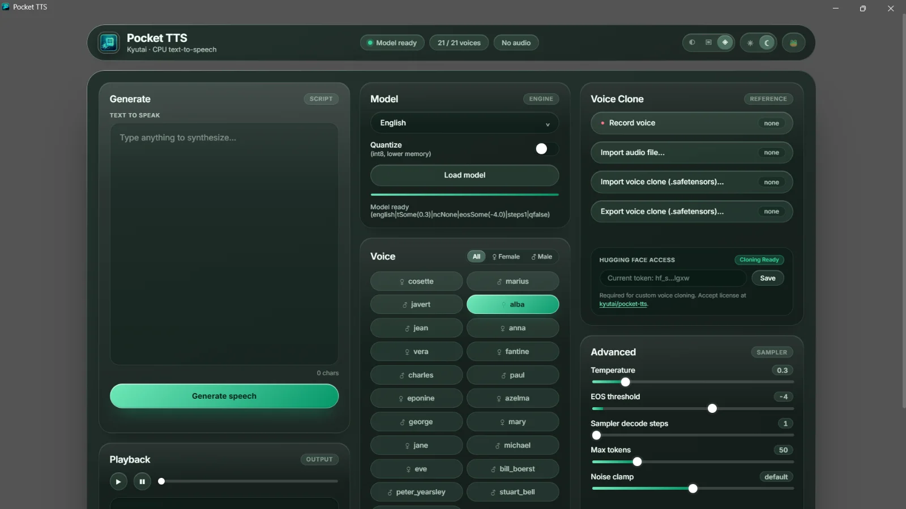

# Pocket TTS Wrapper

A Windows desktop wrapper for [Kyutai Pocket TTS](https://github.com/kyutai-labs/pocket-tts) — a
CPU-only neural text-to-speech engine — with a frosted-glass Tauri UI, 27 built-in voices,
zero-shot voice cloning and an in-app log console.

Made as a side project because a UI is nicer than a command line.



## Features

- **27 built-in voices**, filterable by gender, each with its own speaker embedding — no Hugging
  Face token needed, works fully offline.
- **Voice cloning** from a microphone recording, an audio file (wav/mp3/flac/ogg) or a
  `.safetensors` voice state, with export back to `.safetensors` for instant reuse.
- **CPU only**, with an int8 quantized model option for lower memory use.
- **Glass UI** with four themes and a three-way transparency switcher: transparent glass,
  high-visibility panels, and the Windows acrylic backdrop.
- **No console window** — engine logs stream into the collapsible in-app console instead.
- Playback with waveform, seek, duration/rate readout, and export to WAV, MP3 or Ogg Vorbis.
- **Long-form rendering**: point it at a `.txt` and it renders the whole file to one audio file,
  streaming to disk with progress instead of holding an hour of speech in memory.
- **Updates from inside the app** — the header's download button checks the latest release, and a
  signed update installs and restarts on its own.

## Requirements

- Windows 10 or 11, x64
- [WebView2 runtime](https://developer.microsoft.com/microsoft-edge/webview2/) (preinstalled on
  Windows 11)
- To build: Rust stable with the MSVC toolchain, plus Node.js 18+ for the Tauri CLI

## Install

Download `Pocket-TTS-1.0.0-x64-setup.exe` from
[Releases](https://github.com/Fatalreality/Pocket-TTS-Wrapper/releases), run it, and launch
**Pocket TTS** from the Start menu.

The installer is per-user (no admin prompt), installs into a folder of your choice, adds Start-menu
shortcuts and an uninstaller, and ships `README.txt` and `HF_TOKEN_GUIDE.txt` beside the app. A
portable `Pocket-TTS-*-portable.exe` is attached to each release as well.

## Build from source

```powershell
git clone https://github.com/Fatalreality/Pocket-TTS-Wrapper.git
cd Pocket-TTS-Wrapper

cargo build --release          # binary only
npx @tauri-apps/cli@2 build    # binary + NSIS installer in target/release/bundle/nsis
cargo test                     # engine unit tests
```

The build also signs the updater payload, which needs `TAURI_SIGNING_PRIVATE_KEY` in the
environment — see [`RELEASING.md`](RELEASING.md). Releases are built and published by the
`Release` workflow when a `v*` tag is pushed.

The frontend is plain static HTML/CSS/JS in `pocketGlass/ui` — there is no npm build step. Tauri
embeds it into the binary at compile time, so rebuild after editing any UI file. The model configs
from the upstream project are vendored in `configs/` and embedded the same way, so no separate
checkout of `pocket-tts` is needed to build.

## Voice cloning token

Cloning uses the gated `kyutai/pocket-tts` weights on Hugging Face:

1. Accept the terms at <https://huggingface.co/kyutai/pocket-tts>.
2. Create a **Read** token at <https://huggingface.co/settings/tokens>.
3. Paste it into **Voice Clone → Hugging Face Access** in the app and press **Save**.

The token is stored in `~/.cache/huggingface/token` and reused. Full walkthrough in
[`docs/HF_TOKEN_GUIDE.txt`](docs/HF_TOKEN_GUIDE.txt).

## Shortcuts

| Keys | Action |
| --- | --- |
| `Ctrl` + `Enter` | Generate speech |
| `Space` | Play / pause |

## Repository layout

| Path | Purpose |
| --- | --- |
| `src/` | Rust side: Tauri commands, model/voice state, audio I/O, text chunking |
| `src/main.rs` | Window setup, Windows glass/acrylic chrome, command registration |
| `pocketGlass/ui/` | Frontend (`index.html`, `app.js`, `styles.css`), embedded at compile time |
| `configs/` | Model YAML configs vendored from upstream Pocket TTS, embedded at compile time |
| `src/encode.rs` | WAV, MP3 and Ogg Vorbis writers, plus the WAV decoder for re-encoding |
| `vendor/ptts/` | Inference crate vendored from `xn-ptts`, with teacher-forced chunk continuation added |
| `docs/` | User guides bundled into the installer, plus the README screenshot |
| `scripts/release.mjs` | Version bump, changelog notes, asset staging and publishing |
| `capabilities/`, `src-tauri/` | Tauri permissions and app icon |

## Credits & license

TTS engine and model weights by [Kyutai](https://kyutai.org/) (Pocket TTS); inference through
[`xn-ptts`](https://github.com/gabrieldemarmiesse/xn-ptts). Voice embeddings come from Kyutai's
released voice packs and remain subject to their terms. The model configs in `configs/` are
vendored from the upstream Pocket TTS project, and `vendor/ptts/` from `xn-ptts` (MIT OR
Apache-2.0); see `vendor/ptts/VENDORED.md` for the two additions it carries.

This wrapper's own code — the Rust application in `src/` and the frontend in `pocketGlass/ui` — is
released under the [MIT License](LICENSE), © 2026 Fatalreality. The MIT license covers only that
code: Kyutai's model weights, voice embeddings and the vendored upstream configs keep their own
terms.
